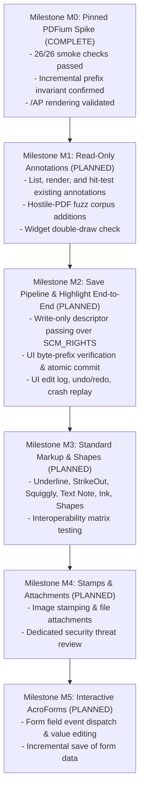

# Architecture & Project Status Report: Linux PDF Reader

## Executive Summary

The project has established a production-grade, native Linux PDF workstation powered by **C++20**, **Qt 6**, and **PDFium** (pinned Chromium/8100 release). The architecture implements the Chromium security model: the UI process (`pdf-reader`) remains completely unlinked from PDFium and delegates all document parsing, rasterization, text search, and redaction to an isolated `pdf_worker` process operating under kernel-enforced sandboxing.

### High-Level Status
- **Process Confinement & Threat T1 (100% Complete)**: Worker confined under Landlock ABI 1–5 (denying both arbitrary filesystem reads and writes), Seccomp BPF filters, resource limits (`RLIMIT_AS = 4 GiB`, `RLIMIT_CPU = 7200s`, `PR_SET_PDEATHSIG = SIGKILL`), and document descriptor passing over UNIX domain sockets via `SCM_RIGHTS`.
- **Core Viewer & Workstation Features (100% Complete)**: Continuous 64-bit layout, multi-spread view modes, arbitrary page rotation, thumbnail/page label sidebar, bookmarks outline, full-text Persian/Arabic RTL search, dark mode/reading themes, multi-document tabs, and native CUPS printing.
- **Pixel Redaction Engine (100% Complete)**: Structural PDF sanitization, metadata elimination, vector flattening, UI mark staging, and source overwrite prevention.
- **Distribution & Hardening (100% Complete)**: Flatpak packaging on KDE 6.10 runtime with automated container testing, IPC mutation fuzzing suite, and binary hardening (`PIE`, full `RELRO`, `BIND_NOW`).
- **Phase 2 Annotations & Save Pipeline (In Progress)**: RFC finalized with owner decisions recorded; Milestone M0 spike verified on pinned Chromium/8100 PDFium (26/26 smoke checks, incremental byte-prefix preservation, and custom `/AP` appearance stream rendering).

---

## 1. System Architecture

```mermaid
flowchart TD
    subgraph UI ["UI Process (pdf-reader) - Zero PDFium Linkage"]
        MW["MainWindow & Actions"]
        VW["PdfViewerWidget (Layout, Zoom, Tiling)"]
        WC["WorkerClient (Lifecycle, Heartbeats, Watchdog)"]
        TC["TileCache (LRU Eviction, Tombstones)"]
        SB["Sidebars: Thumbnails, Outline, Search Results"]
        TAB["Multi-Document Tab Bar & Session Manager"]
        RED_UI["Redaction Staging & File Safety Guards"]

        MW --> VW
        MW --> SB
        MW --> TAB
        MW --> RED_UI
        VW --> WC
        VW --> TC
    end

    subgraph IPC_Transport ["Inter-Process Communication Boundary"]
        SCM["UNIX Domain Socket (SCM_RIGHTS FD Passing)"]
        SOCK["Framed IPC Protocol (64 MiB Cap, Magic 0x50444657)"]
        SHM["POSIX Shared Memory (/dev/shm, UUID-named 0600)"]
    end

    subgraph Sandbox ["Isolated Sandboxed Worker (pdf_worker)"]
        WS["WorkerServer (Packet-Bounded FD Association)"]
        RW["RenderWorker (Serialized Thread & Priority Queue)"]
        ENG["PDFium Engine (loadFromDescriptor, Pread Stream)"]
        RED_ENG["Redaction Engine (Burn-in, Sanitization)"]

        subgraph Confinement ["Kernel Defense-in-Depth"]
            LL["Landlock ABI 1-5 (Read & Write Denial)"]
            SC["Seccomp BPF (execve, connect, TCP, D-Bus Denied)"]
            RL["RLIMIT_AS=4GiB, CPU=7200s, NOFILE=256"]
            PR["PR_SET_NO_NEW_PRIVS, PDEATHSIG=SIGKILL, DUMPABLE=0"]
        end

        WS --> RW
        RW --> ENG
        RW --> RED_ENG
        Confinement -.-> WS
    end

    WC <-->|SCM_RIGHTS: Read-Only Document FDs| SCM
    WC <-->|Framed Requests / Responses / Progress Pings| SOCK
    SOCK <--> WS
    SCM --> WS
    WS -->|Raster Tiles| SHM
    SHM -->|pread() Zero-Copy Bounds-Validated Read| WC
```

---

## 2. Completed Milestones & Capabilities

| Subsystem | Milestone / Capability | Architectural Highlights |
|---|---|---|
| **Process Sandboxing (Phase 4 / Threat T1)** | **Chromium Security Model & Descriptor Passing** | Document FDs opened read-only by UI and passed over `SCM_RIGHTS`. Worker has zero path-based filesystem access (Landlock read/write denial). Packet-bounded descriptor association (`recvmsg`) rejects/closes stray descriptors. Seccomp BPF blocks network/execve. Fail-closed startup policy. |
| **Engine Core** | **Google PDFium Integration** | Cryptographically verified CMake `FetchContent` (Chromium/8100). Pure Qt-free raster core (`PixelBuffer`). Unconstrained deep zoom virtual tiling (512أ—512 grid). Scale-preserving whole-page clamping (8192 px / 16 MP cap). In-memory document buffer safety. |
| **Document Layout** | **64-bit Layout & View Modes** | Standalone static library (`pdf_layout`) with zero Qt/PDFium dependencies. Continuous layout, Single Page, Two-Page, Two-Page with Cover view modes. Arbitrary 90آ°/180آ°/270آ° document rotation. Subpixel-safe 2D cursor zoom anchor pinning. |
| **Tile Caching** | **Multi-Scale LRU Tile Cache** | Thread-confined `TileCache` with LRU eviction, byte accounting, pinned tile protection, DPR/scale quantization, and exponential failure tombstones with explicit clearing. |
| **Navigation & UI** | **Thumbnails & Bookmarks Outline** | Lazy-loading thumbnail sidebar (`ThumbnailListWidget`) with two-way viewport synchronization and page label extraction (`FPDF_GetPageLabel`). Document outline tree (`QTreeView`) with cycle detection and depth limits. |
| **Session Management** | **Multi-Document Tabs & Recent Files** | Dynamic tab interface (`Ctrl+T`, `Ctrl+W`, `Ctrl+Tab`), per-tab viewer isolation, recent files menu with `QSettings` persistence, and reading position memory (DPI-independent fractional offset and fingerprint recovery). |
| **Text Search** | **Unicode & Persian/Arabic RTL Search** | Persian/Arabic text normalization, whitespace folding, bidirectional highlight box merging, FindBar match cycling, and sidebar search results panel with live hit snippets. |
| **Viewing Modes** | **Dark Mode & Reading Themes** | LUT-based color mode post-processing (Normal, Inverted/DarkMode `#181818`, Sepia, High Contrast) with hue preservation and zero-mutation reversibility. |
| **Printing & Export** | **CUPS Native Printing & PDF Export** | Zero-PDFium UI printing via IPC `RenderPageRequest`, native print dialog (`QPrintDialog`), and headless PDF export. |
| **Burn-in Redaction** | **Sanitization & Overwrite Guards** | End-to-end pixel redaction engine: vector and image flattening, metadata/stream sanitization, UI mark staging, and strict atomic save guards preventing source file collisions. |
| **Security Fuzzing** | **IPC Mutation Fuzz Testing** | Dedicated `IpcFuzzTestSuite` executing 1,000+ randomized mutation fuzz tests against deserializers to guarantee boundary defense against hostile packets. |
| **Linux Packaging** | **Flatpak & Sandbox Verification** | Official Flatpak manifest (`org.greenware.PDFReader.yaml`) on KDE 6.10 runtime. Automated test runner (`scripts/test_flatpak_sandbox.sh`) verifying Landlock confinement and host font mapping under `flatpak run`. |

---

## 3. Test Verification (10 Suites, 118+ Tests, 100% Pass)

The project enforces automated test execution through CTest, GitHub Actions CI, and local container verification:

1. **`EngineRenderTestSuite` (25 Tests)**:
   - Handle lifetimes, render whole page caps, 37px grid-shift tile stitching, sub-pixel edge straddling at 15أ— zoom.
   - Text extraction (`PageText`), supplementary Unicode (>0xFFFF), surrogate pairs, Persian RTL extraction and search.
   - Outline hierarchical extraction, page labels, rotation corner-color fixtures, form field rendering, search snippets, and descriptor-backed streaming.
2. **`DocumentLayoutTestSuite` (12 Tests)**:
   - Untrusted dimension hardening, horizontal centering, 1,000 randomized property tests vs brute force, 64-bit coordinate verification ($>2^{31}$ px), scroll mapping at $10^9$ range, multi-spread view modes, and page rotation.
3. **`TileCacheTestSuite` (13 Tests)**:
   - LRU eviction order, pinned tile immunity, invalidation pruning, scale/DPR quantization, randomized model comparison, exponential backoff tombstones, and retry exhaustion recovery.
4. **`ViewportWidgetTestSuite` (45 Tests)**:
   - Non-blocking asynchronous document open (deflaked timing), smooth continuous scrolling without starvation, in-flight tile deduplication, zoom fallback, prefetch rings.
   - Text selection (single/cross-page, supplementary Unicode, rotated/cropped pages), FindBar match cycling, outline/thumbnail sidebars, dark mode `#181818` viewport color, keyboard navigation, redaction mark staging, and search results panel.
5. **`WorkerIpcTestSuite` (28 Tests)**:
   - Shared-tile transport bounds security and shrunken segment SIGBUS defense.
   - Versioned protocol negotiation, document loading over IPC with descriptor passing, thumbnail/print/text extraction over IPC.
   - Crash resilience and clean socket disconnect teardown.
   - Deterministic isolation probe (`--isolation-selftest`) verifying read/write Landlock confinement, seccomp BPF denial, and foreign `/dev/shm` blocking.
   - Watchdog heartbeat progress monitoring across engine hangs and long workloads.
   - **Tests 19A–19I**: Outside-worker pipe-observable descriptor lifecycle (`POLLERR` verification of packet association, non-Open rejection, stray descriptor closure, coalesced packet isolation, multi-descriptor rejection, and mid-packet disconnect hygiene).
   - **Tests 20a–20b**: Confined worker non-Latin text rendering (embedded unicode vs. non-embedded CID Japanese CJK system fonts via fontconfig).
   - **Tests 21a–21b**: Dynamic font-root probing (`--test-probe-read`) verifying the worker can read host font directories (including Flatpak `/run/host/fonts`), with truthful skip reporting when host fonts are absent.
6. **`PasswordPromptTestSuite`**:
   - Headless encrypted document handling, incorrect password rejection, and correct password unlocking.
7. **`RedactionRotationTestSuite`**:
   - End-to-end pixel-level redaction verification with `pdftoppm` witness across rotated pages and multi-page fixtures.
8. **`RedactionFileSafetyTestSuite`**:
   - Atomic all-or-nothing save guards and source file overwrite prevention.
9. **`RedactionTestSuite`**:
   - Comprehensive redaction engine tests verifying structural sanitization, complete metadata elimination, and independent parser inspection.
10. **`IpcFuzzTestSuite`**:
    - 1,000+ randomized mutation fuzz tests verifying parser resilience against malformed IPC packets.

### Continuous Integration Matrix
A GitHub Actions matrix workflow runs on `ubuntu-24.04`:
- **Release Matrix Build**: Test hooks enabled (`ENABLE_TEST_HOOKS=ON`), full automated CTest execution with offscreen platform (`QT_QPA_PLATFORM=offscreen`).
- **Sanitizer Matrix Build (ASan / UBSan)**: AddressSanitizer and UndefinedBehaviorSanitizer (`detect_leaks=1:abort_on_error=1`).
- **ThreadSanitizer Matrix Build (TSan)**: Multi-threaded data race detection across single-process suites.
- **Shipping Configuration Job (`ENABLE_TEST_HOOKS=OFF`)**: Verifies fault-injection hooks are stripped, binary hardening flags (`PIE`, full `RELRO`, `BIND_NOW`) are present, and runs shipping test suite.

---

## 4. Current Work: Phase 2 — Annotations, Save Pipeline & Forms

Phase 2 introduces document modification and saving while strictly preserving write confinement and fail-closed security.

### Architectural Decisions (Recorded in RFC)
- **Save Pipeline**: UI process passes a single write-only descriptor via `SCM_RIGHTS` to a temporary file. Worker streams `FPDF_SaveAsCopy` with heartbeat progress callbacks. UI verifies file size, header, and exact byte-prefix before atomic rename commit.
- **Save As by Default**: Protects original user files from accidental overwrites; confirmed in-place save allowed only with explicit user confirmation and file modification checks.
- **UI-Owned Edit Log**: Semantic commands (`AddAnnotation`, `ModifyAnnotation`, `DeleteAnnotation`) owned by UI. Undo/redo lives in UI without PDFium linkage. Worker crashes lose zero work (UI restarts worker and replays log).
- **Appearance Streams (`/AP`)**: Custom appearance streams generated explicitly via `FPDFAnnot_SetAP` to ensure interoperability with third-party viewers (Acrobat, Foxit, Okular).
- **Popup Strategy**: Note content stored in standard `/Contents` string entry; popup presentation handled via native Qt UI overlays without synthesizing unlinked `/Popup` dictionary objects.
- **Flatpak Permissions**: File saves operate strictly via the XDG Desktop File Chooser Portal (`org.freedesktop.portal.FileChooser`) with no broad filesystem write permissions added to the manifest.

### Implementation Milestones



---

## 5. Next Immediate Steps

1. **Finalize PR #30**: Complete AddressSanitizer CI run on [PR #30](https://github.com/greenware63/PDF_Reader_for_Linux/pull/30) and merge the finalized Phase 2 RFC into `main`.
2. **Launch Milestone M1**:
   - Define read-only IPC messages (`ListAnnotationsRequest`, `ListAnnotationsResponse`, `HitTestAnnotationRequest`, `HitTestAnnotationResponse`).
   - Implement worker-side annotation enumeration and bounding box queries.
   - Implement UI-side annotation hover tooltips and selection highlight rendering.
   - Add hostile-PDF fuzz corpus items for annotation structures (cyclic dictionaries, deep popup trees, malformed quadpoints).
