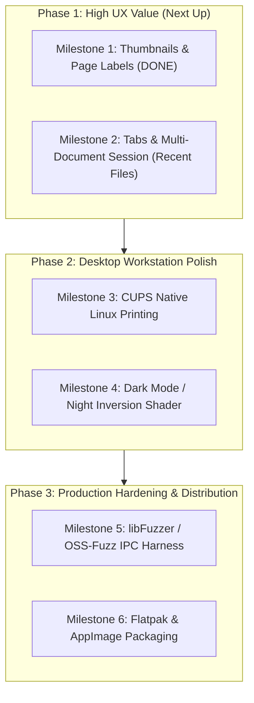

# Architecture & Project Status Report: Linux PDF Reader

## Executive Summary

The project has achieved a major milestone by transitioning to a **multi-process sandboxed worker architecture** (the Chromium security model) and completing **Milestone 1 (Thumbnails & Page Labels Sidebar)**. All rendering and PDF parsing logic is isolated in a standalone `pdf_worker` binary under OS-level sandboxing, while the UI process (`pdf-reader`) remains completely unlinked from PDFium.

---

## 1. What Has Been Completed

### A. Sandboxed Multi-Process Worker Architecture

```mermaid
flowchart LR
    subgraph UI ["UI Process (pdf-reader)"]
        W["MainWindow / PdfViewerWidget"]
        WC["WorkerClient"]
        C["TileCache (QPixmap/QImage)"]
        Thumb["ThumbnailListWidget"]
        W --> WC
        W --> C
        W --> Thumb
    end

    subgraph IPC ["Inter-Process Communication"]
        Sock["Local Socket (Framed IPC Protocol)"]
        Shm["POSIX Shared Memory (/dev/shm)"]
    end

    subgraph Worker ["Isolated Process (pdf_worker)"]
        WS["WorkerServer"]
        Engine["PDFium Engine"]
        Sandbox["Linux Sandbox:\n- PR_SET_PDEATHSIG\n- PR_SET_NO_NEW_PRIVS\n- Landlock FS Confinement"]
        WS --> Engine
        Sandbox -.-> WS
    end

    WC <-->|Control, Outline, Search, Thumbnails| Sock
    Sock <-->|Requests & Metadata| WS
    WS -->|Raster Tiles| Shm
    Shm -->|pread() Zero-Copy Read| WC
```

| Step | Milestone | Delivered Capabilities |
|---|---|---|
| **Sandboxing & IPC** | **Chromium Security Model** | Typed framed IPC protocol, POSIX shared-memory tile transport (`/dev/shm`), Landlock filesystem restrictions, `PR_SET_PDEATHSIG`, and crash recovery banner. |
| **Milestone 1** | **Thumbnails & Page Labels Sidebar** | Multi-tab sidebar (`QTabWidget`), PDF page label extraction via PDFium `FPDF_GetPageLabel`, lazy-loading miniature thumbnail grid with card styling, prefetching window, and two-way viewport synchronization. |

---

### B. Core Viewer & UX Capabilities

1. **Thumbnails & Page Labels (Milestone 1):**
   - High-performance, lazy-loading thumbnail sidebar (`ThumbnailListWidget`) integrated into `MainWindow` via `QTabWidget` tabs ("Pages" and "Bookmarks").
   - PDF page label extraction (`FPDF_GetPageLabel`) with 1-based index fallback.
   - Two-way viewport synchronization: scrolling document viewport updates thumbnail selection; clicking thumbnail smoothly jumps viewport to page.
   - Dedicated IPC messages (`ThumbnailRequest`, `ThumbnailResponse`, `ThumbnailFailedResponse`) with size cap validation.
2. **Document Outline / Bookmarks Sidebar:**
   - Document outline tree (`QTreeView`) with cycle detection, depth limits (128 levels), destination coordinate scrolling, and dynamic active item tracking.
3. **Continuous 64-bit Document Layout:**
   - Sub-pixel safe coordinate mapping, compressed scrollbars for arbitrarily long documents without slider overflow.
4. **Smooth Zooming & Viewport Anchoring:**
   - 2D cursor anchor zoom and subpixel-accurate fit-width without horizontal scrollbar flutter.
5. **Multi-Scale Tile Cache:**
   - 512x512 tile grid with scaled fallback tiles displayed while full-resolution tiles render.
6. **Text Extraction & Selection:**
   - Asynchronous glyph extraction, word hit-testing, mouse drag selection, and clipboard copy.
7. **Asynchronous Text Search:**
   - Non-blocking page-by-page background search with progress reporting, match cycling, and highlight overlays.
8. **Password Protection:**
   - Encrypted PDF detection with modal password prompt and asynchronous retry.

---

### C. Test Verification (100% Pass)

All 6 test suites in CTest pass with 0 failures:
- `EngineRenderTestSuite`: PDFium core rendering, rotation, crop boxes.
- `DocumentLayoutTestSuite`: Continuous vertical layout and 64-bit coordinates.
- `TileCacheTestSuite`: LRU tile eviction, memory bounds, tombstone retries.
- `ViewportWidgetTestSuite` (35 tests): Offscreen rendering, DPR injection (1.0, 1.5, 2.0), continuous scrolling under load, bookmark navigation, search cycling, worker crash containment, and **ThumbnailListWidget IPC delivery and two-way viewport synchronization**.
- `PasswordPromptTestSuite`: Authentication workflow and invalid password rejection.
- `WorkerIpcTestSuite` (8 tests): Direct IPC socket serialization, control ping/pong, crash recovery, and **isolated worker thumbnail rendering over IPC**.

---

## 2. What Remains to Be Addressed (Roadmap)



### Next Immediate Target: Milestone 2 — Document Tabs & Session Management
- Multi-document tab bar (`QTabBar` / `QTabWidget` central area).
- Recents menu (`QSettings` persistence with thumbnail preview or metadata).
- Tab reordering, close buttons, and keyboard shortcuts (`Ctrl+W`, `Ctrl+Tab`).
